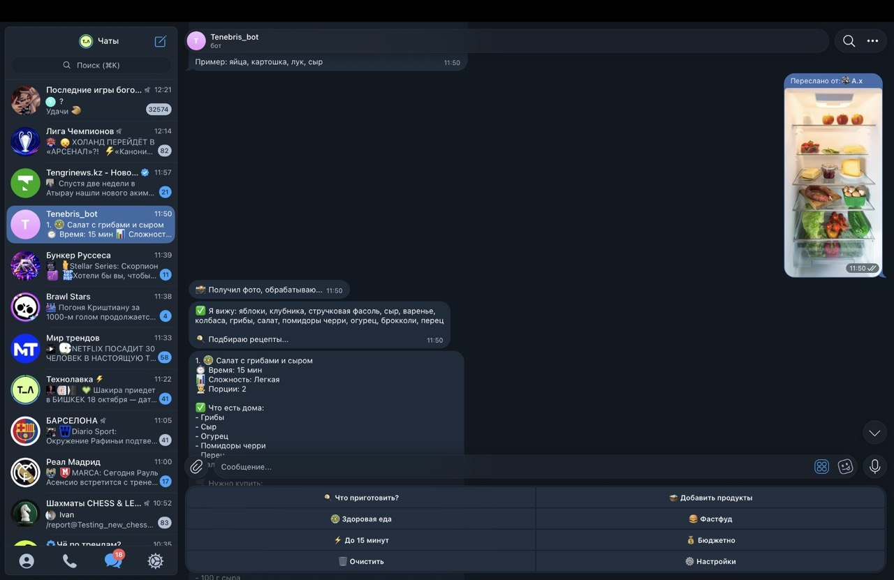

# 🍗 Chicken Bot
**Telegram - Бот** который подскажет что вам выбрать когда вы голодный и не знаете что приготовить из имеющихся продуктов

---
### 📱 Демонстраии работы нашего проэкта

---

### Ключевые возможности
- 🗄️**Из любых ингредиентов что есть в холодильнике сожно разного рода еду**
- 🤖**Огромная разнобразия блюд** - имеет огромную базу разных блюд благодаря встроенному ИИ
- 🍲**Пошаговые инструкции** - Фоткаешь игредиенты/продукты, спрашиваешь что можно приготовить, прочитать рецепт, приготовить блюдо

---

### Стэк технологии
- 🐍**Язык:** Python 3.10
- ⚙️**Библиотеки:** openai,
- 📘**API:** Telegram-API

--- 
### 👨‍💻Авторы
**Бекембаев Санжар 10D**  
**Жаталап Нуриддин 10D**  
**Турбек Куат 10D**  
**Алимжанов Азимжан 10D**  
---

### Настройка API-ключей

Для запуска бота нужны токен Telegram и API-ключ сервиса искусственного интеллекта.

1. Создайте Telegram-бота через [@BotFather](https://t.me/BotFather) и получите токен.
2. Получите API-ключ используемого ИИ-сервиса.
3. Перед запуском задайте оба значения как переменные окружения. Используйте имена переменных, указанные в `main.py`.
4. В GitHub Codespaces добавьте ключи в **Settings → Secrets and variables → Codespaces**.

Не публикуйте реальные ключи в коде или README. Каждый, кто запускает проект, должен использовать собственные ключи.
# Thanks for your attention!